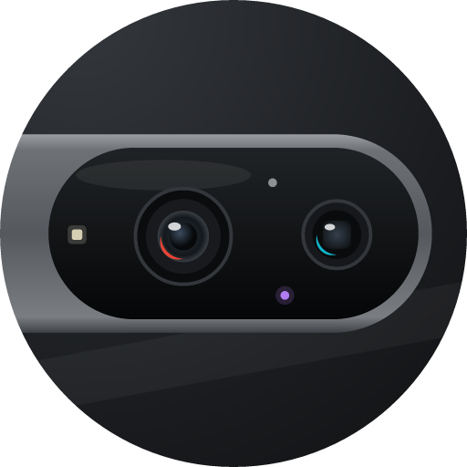
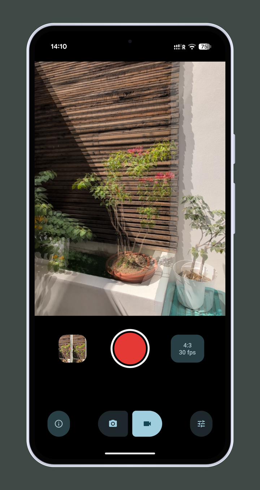
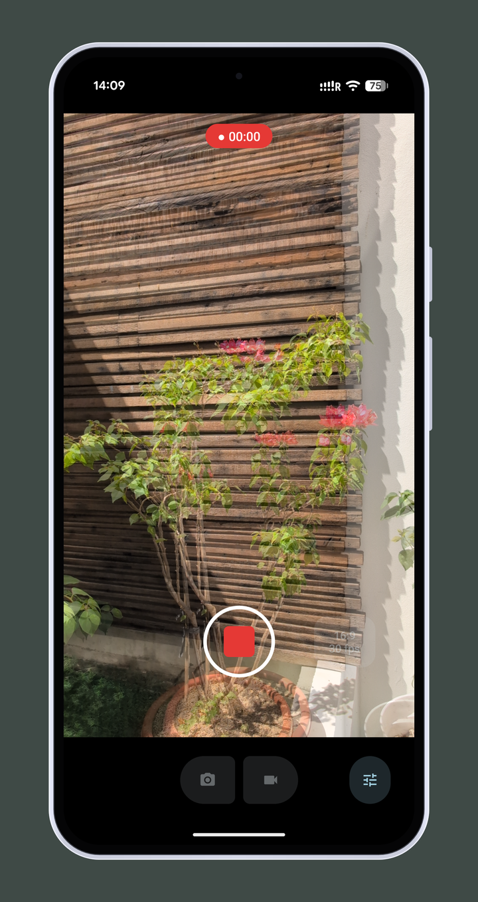
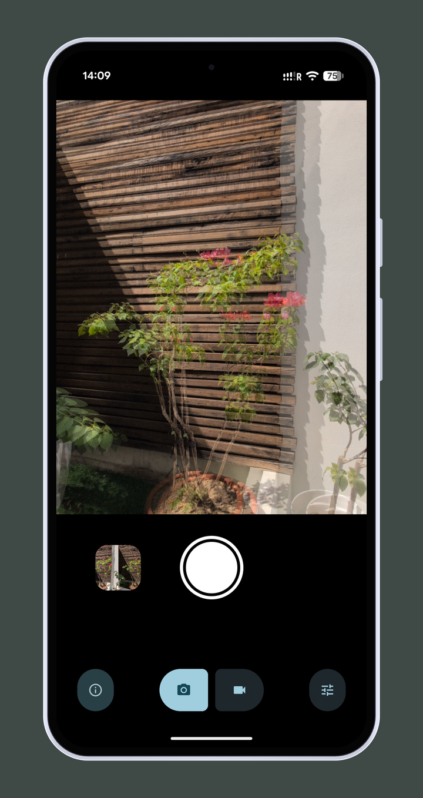
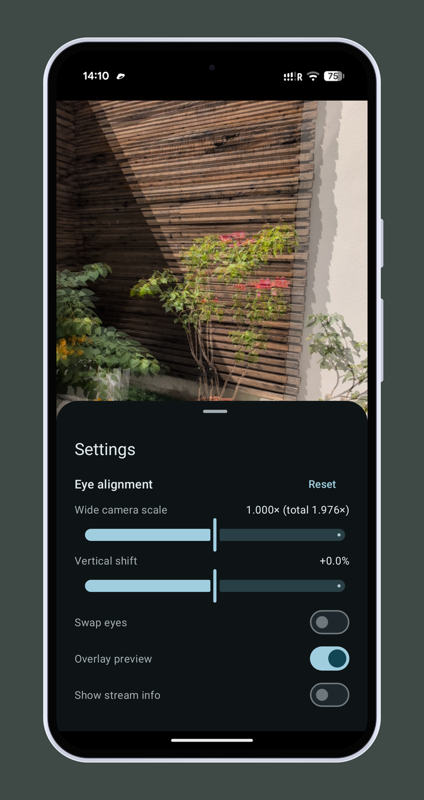

<p align="center"></p>
<h2 align="center"><b>Stereo Camera</b></h2>
<h4 align="center">3D Side-by-Side photos and videos from two rear cameras of your Android phone.</h4>

<p align="center">
<a href="https://github.com/vladimir-kalinin/3d_camera/releases/latest"></a>
<a href="LICENSE"></a>


</p>

<hr>
<p align="center"><a href="#screenshots">Screenshots</a> &bull; <a href="#features">Features</a> &bull; <a href="#installation">Installation</a> &bull; <a href="#requirements">Requirements</a> &bull; <a href="#building">Building</a> &bull; <a href="#architecture">Architecture</a> &bull; <a href="#license">License</a></p>
<hr>

Stereo Camera shoots stereo photos and videos in Side-by-Side (SBS) format using two rear cameras
of a phone at once: the ultra-wide and the main one. The SBS frame is composed on the GPU in real time,
so the result is ready to watch in a VR headset or on a 3D display right away. Developed and tested on Pixel 9.

## Screenshots

<p align="center">
<a href="docs/screenshot_1.png"></a>
<a href="docs/screenshot_2.png"></a>
<a href="docs/screenshot_3.png"></a>
<a href="docs/screenshot_4.png"></a>
<a href="docs/screenshot_5.png"></a>
</p>

The preview shows both eyes overlaid at 50% opacity — saved photos and videos are always Side-by-Side.

## Installation

Download the APK from the [latest release](https://github.com/vladimir-kalinin/3d_camera/releases/latest),
open it on the phone and allow installing apps from this source. Updates are installed the same way, over
the existing app.

## Features

- Preview, photos and video are produced directly in SBS: the frame is composed on the GPU in real time,
  no post-processing or stitching is needed.
- Video is written as a single MP4 with stereo sound straight into the gallery. Photos and videos go to
  one folder, `DCIM/3D Camera` (a single album). The `_SBS` suffix in file names helps VR players detect the format.
- Frames of the two cameras are paired by capture timestamp; desync and unpaired frames are shown in the status card.
- The ultra-wide frame is automatically cropped to the field of view of the main camera using lens calibration
  (`LENS_INTRINSIC_CALIBRATION`); eye order comes from `LENS_POSE_TRANSLATION`.
  Manual scale / vertical shift adjustment and eye swap are in the "Settings" sheet (bottom-right button).
- Colors of the ultra-wide camera are matched to the main one in software (the two sensors run independent
  auto white balance and exposure, so the eyes drift apart in mixed light and at sunset).
- By default the preview shows both eyes overlaid at 50% opacity, like a regular camera (this also makes
  alignment visible). SBS preview and the stream stats card can be toggled in "Settings".
  Recorded photos and videos are always SBS.
- Modes:
  - **Photo** — both cameras take a full-resolution JPEG (4032×3024) in a single request,
    and a 6048×4032 SBS image is composed on the CPU (`StillComposer`) with the same geometry as the preview.
  - **Video** — aspect ratio and frame rate are chosen separately in the "Video settings" panel
    (the button with the current format next to the shutter, modeled after Google Camera):
    - **4:3** — both cameras stream 2048×1536, SBS 3072×2048, 30 fps only;
    - **16:9** — main 1920×1080, ultra-wide 3840×2160, SBS 2160×1920, 30 or ~57 fps.
      After the crop both eyes are equally sharp, but the horizontal field of view is 25% narrower.

    The camera delivers 60 fps only on 16:9 streams, so choosing 4:3 switches to 30 fps and choosing 60 fps switches to 16:9.
- Overheating warnings: when the phone gets hot, Android lowers the frame rate and may stop one of the cameras.

## Requirements

- Android 11+ (minSdk 30).
- A logical rear camera that exposes two physical cameras (ultra-wide + main) and allows streaming from both
  simultaneously. Only Pixel 9 has been tested; other phones may work, but camera HALs differ a lot.

## Building

Open the project in Android Studio, or build from the command line (JDK 17+ is required, the one bundled
with Android Studio works):

```bash
./gradlew assembleDebug
```

```bash
adb install -r app/build/outputs/apk/debug/app-debug.apk
```

Application ids: release — `io.github.vladimir_kalinin.stereocamera`, debug — the same with `.dev` suffix
(shown as "Stereo Camera dev"), so both can be installed side by side. Calibration settings are stored
separately per build.

### Release signing

Without a signing key `./gradlew assembleRelease` produces an unsigned APK. To sign it, create a
`keystore.properties` file in the project root (it is git-ignored):

```properties
storeFile=/path/to/release.jks
storePassword=...
keyAlias=...
keyPassword=...
```

or set the environment variables `STEREOCAMERA_STORE_FILE`, `STEREOCAMERA_STORE_PASSWORD`,
`STEREOCAMERA_KEY_ALIAS`, `STEREOCAMERA_KEY_PASSWORD`.

### Debug option

Force the ultra-wide stream size (useful for measurements):

```bash
adb shell am start -n io.github.vladimir_kalinin.stereocamera.dev/io.github.vladimir_kalinin.stereocamera.MainActivity --es wide_size 2048x1536
```

`am start` does not restart an already open activity: to apply a new parameter, `am force-stop` the app first.

## Architecture

```
camera/StereoRig        choice of the camera pair, alignment geometry, stream sizes, video formats
camera/StereoCamera     logical camera, one capture session with two physical streams (+ two JPEG streams in photo mode)
gl/StereoRenderer       frame intake, crop into per-eye ring buffers, pairing by timestamp, SBS rendering
gl/ColorMatch           matching ultra-wide colors to the main camera
gl/EglCore, GlUtil      EGL context (compatible with the encoder surface) and GL helpers
media/SbsVideoRecorder  MediaCodec + MediaMuxer: H.264 video from the GL surface + AAC stereo audio
media/StillComposer     full-resolution SBS photo from two JPEGs
media/MediaSaver        saving photos and videos straight into MediaStore
MainActivity            UI and lifecycle only
```

Camera, GL and media logic live in their own packages; `MainActivity` only handles UI and lifecycle.
The camera must be closed in `onPause`, in this order: recording → camera → renderer.

### Frame pipeline

Frames of the two cameras arrive out of order, up to ~4 frames apart and in bursts. A frame cannot be kept
in the `SurfaceTexture` queue while waiting for its pair — the camera would run out of buffers and start
dropping frames. So the renderer consumes every frame immediately, draws it already cropped into the eye's
ring buffer (`StereoRenderer.EyeStream`), and pairs are then matched by timestamp (tolerance 15 ms).
The camera timestamp is passed to the encoder, so audio and video stay in sync.

### Alignment geometry

The ultra-wide frame is cropped to the main camera's field of view (≈1.976× on Pixel 9) with optical centers
aligned. A 16:9 stream is a center crop of the 4:3 sensor, so optical centers are converted into its
coordinates (`principalIn`).

The geometry is implemented twice: in the shader (`StereoRenderer.renderEye`) and in
`StillComposer.eyeMatrix` for full-size photos. **When changing one, change the other.**

### Color matching

Physical cameras have independent AWB/AE, and `CONTROL_AWB_MODE` can only be set for the logical camera;
color gains/transform keys only work with AWB off, and the sensors have different color matrices.
So colors are matched in software: per-channel gains are computed in linear light from mean R/G/B of both eyes
over the same points (overexposed and too dark points are skipped).

- Video: gains are applied in the shader, measured on downscaled eye frames (`updateColorMatch`, no fps cost).
- Photo: gains are recomputed for each JPEG pair (`StillComposer.colorGains`), because full-size captures
  are processed differently from the preview.

### Video recording

Video is encoded with MediaCodec + MediaMuxer rather than MediaRecorder. MediaRecorder doesn't allow setting
the color space, and for frames of ~6.3 MP and above (3072×2048 qualifies) Android tags the video as BT.2020,
which makes players oversaturate colors. The app explicitly sets BT.709 / SDR / limited range
(check the VUI in SPS and the `colr` box in the MP4).

Audio comes from the `CAMCORDER` source with ~0.25 s latency: on stop the buffer is drained up to the stop
moment, otherwise the end of the audio is cut. Audio timestamps come from `AudioRecord.getTimestamp`
(the same `System.nanoTime` clock as the video frames).

### Photo mode

Photos must not be taken with a video preset: with `TEMPLATE_RECORD` and fps [30, 30] exposure is capped at
1/30 s, ISO goes up and noise reduction eats the details. In photo mode the repeating request uses
`TEMPLATE_PREVIEW` with fps [15, 30]; the still capture uses `HIGH_QUALITY` NR/EDGE and JPEG streams with
the `STILL_CAPTURE` stream use case. The session in photo mode: two 2048×1536 preview streams + two
4032×3024 JPEG streams (preview runs at ~20–23 fps). If the HAL rejects the JPEG streams, the photo is taken
from a GL frame (`StereoRenderer.capturePhoto`) with a larger ultra-wide stream.

Composing a 6048×4032 photo on the CPU needs ~160 MB, hence `largeHeap` in the manifest.

### UI

Material 3 (`Theme.Material3.DynamicColors.Dark`), colors follow the wallpaper like in Google Camera.
Buttons in layouts are declared as `MaterialButton` (not `<Button>`), otherwise view binding produces a type
without `isChecked`. Don't change padding of a `ShapeableImageView` at runtime — its shape mask is not recomputed.

## Pixel 9 camera notes

- Logical rear camera `0` with physical cameras `2` (main, 6.9 mm), `3` (ultra-wide, 2.02 mm) and `4` —
  an auxiliary "main with 2× sensor crop" whose `LENS_INTRINSIC_CALIBRATION` is wrong. That's why the pair is
  chosen by focal length and physical sensor size, and calibration is used only when it agrees with physics
  (`StereoRig.describe`).
- The ultra-wide lens is 16 mm left of the main one (`LENS_POSE_TRANSLATION`, X axis), so in portrait it is
  the left eye. Human interocular distance is ~63 mm, so depth is noticeable mostly on close-ups.
- `SENSOR_INFO_TIMESTAMP_SOURCE = REALTIME`, sensor sync is `APPROXIMATE`: actual exposures differ by
  10–28 ms. This is a hardware limit. With distortion correction on, the HAL gives both frames of one request
  the same timestamp; without it, timestamps differ by 10–28 ms and the 15 ms pairing tolerance breaks.
  Distortion correction (`DISTORTION_CORRECTION_MODE_FAST`) costs ~1 fps but is required for the geometry.
- Physical cameras accept: sensitivity, exposureTime, colorCorrection gains/transform, zoomRatio,
  focusDistance, aeExposureCompensation.
- **Do not set `CONTROL_ZOOM_RATIO` on a physical camera** — it stops the other camera's stream, and after
  such experiments the camera stack may hang until the phone reboots.
- JPEG on both physical cameras goes up to 4032×3024. The hardware H.264 encoder (`c2.exynos.h264.encoder`)
  supports up to 7680×4320.
- **Frame rate.** 60 fps only on 16:9 streams (3840×2160, 2688×1512, 1920×1080…), all 4:3 streams are capped
  at 30. Both cameras in 16:9: 1080p+1080p → ~58, 4K+1080p → ~57, 4K+4K → ~53, 2688×1512×2 → ~50.
  On 4:3 the frame rate depends on the ultra-wide stream size: 4032×3024 → ~25, 2560×1920 → ~28,
  2048×1536 → ~29–30. Hence 4:3 video uses 2048×1536 streams and photos use separate full-size JPEG requests.
  `aeTargetFpsRange` in session parameters changes nothing. GL is not a bottleneck (render thread is 20–30% busy).
- **Overheating.** Thermal status LIGHT starts at ~39 °C skin temperature, MODERATE at ~43 °C. From MODERATE
  the HAL lowers fps and then stops delivering frames of one physical camera (buffers come as
  `onCaptureBufferLost`). If things "suddenly break", check `adb shell dumpsys thermalservice` first.
  Continuous use of both cameras overheats the phone in 10–15 minutes.

## Known limitations

- 4:3 video is recorded from 2048×1536 streams, so the left (ultra-wide) eye is about twice as soft as the
  right one. In photos both eyes come from full-size JPEGs, but the left one is still softer because the
  ultra-wide frame is cropped ~2×. 16:9 video doesn't have this problem.
- At 60 fps the HAL doesn't run autofocus on the ultra-wide camera: it stays at ~1.17 diopters (≈85 cm,
  sharp from about 0.45 m). Manual focus only works with AF off, and the AF mode is shared by both cameras.
- Lens rotation (`LENS_POSE_ROTATION`) is not taken into account, which may cause small vertical misalignment.
- Color matching doesn't update when almost the whole frame is overexposed (e.g. sky at sunset).

## Debugging tips

- Stream stats (SBS size, ultra-wide stream, fps of paired frames, desync within a pair, unpaired frames)
  are shown in the card at the top right of the preview. Over adb: `adb shell uiautomator dump` and look for
  `statusValues` (uiautomator itself loads the phone, use a temporary log in `onStats` for precise numbers).
- Camera characteristics: `adb shell dumpsys media.camera`.
- Measure in 10–15 second runs and close the app between them to avoid overheating.

## Contributing

Code comments and log messages are in Russian; all user-facing text (including error messages) is in English.
Changes to the camera or renderer should be checked on a real device, not only by building.

## License

[MIT](LICENSE)
