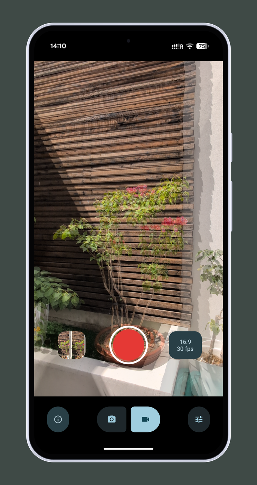

<h2 align="center"><b>Stereo Camera</b></h2>
<h4 align="center">3D Side-by-Side photos and videos from two rear cameras of your Android phone.</h4>

<a href="https://github.com/vladimir-kalinin/3d_camera/releases/latest"><b>⬇ Download the latest APK</b></a>

Stereo Camera shoots stereo photos and videos using the ultra-wide and the main rear cameras at once.
The Side-by-Side (SBS) frame is composed on the GPU in real time, so the result is ready to watch
in a VR headset or on a 3D display right away.

- **Photo** — full-resolution SBS 6048×4032.
- **Video** — 4:3 at 30 fps or 16:9 at 30 / 60 fps, a single MP4 with stereo sound.
- Automatic alignment of the two cameras from lens calibration, with manual fine-tuning.
- Color matching between the cameras, so both eyes look the same.
- The preview overlays both eyes at 50% opacity; saved photos and videos are always SBS.
- Files go to the `DCIM/3D Camera` album with the `_SBS` suffix that VR players recognize.

## Installation

Download the APK from the [latest release](https://github.com/vladimir-kalinin/3d_camera/releases/latest),
open it on the phone and allow installing apps from this source. Updates install over the existing app.

**Requirements:** Android 11+ and a phone that can stream from the ultra-wide and main rear cameras
simultaneously. Only **Pixel 9** has been tested — other phones may or may not work.

**Good to know:** the two lenses are only 16 mm apart, so depth is most visible on close-ups.
Using both cameras heats the phone up; after 10–15 minutes of continuous use Android may lower the frame rate.

## Documentation

- [Architecture](docs/ARCHITECTURE.md) — how it works, Pixel 9 camera notes, known limitations.
- [Development](docs/DEVELOPMENT.md) — building, release signing, debugging, contributing.

## License

[MIT](LICENSE)
